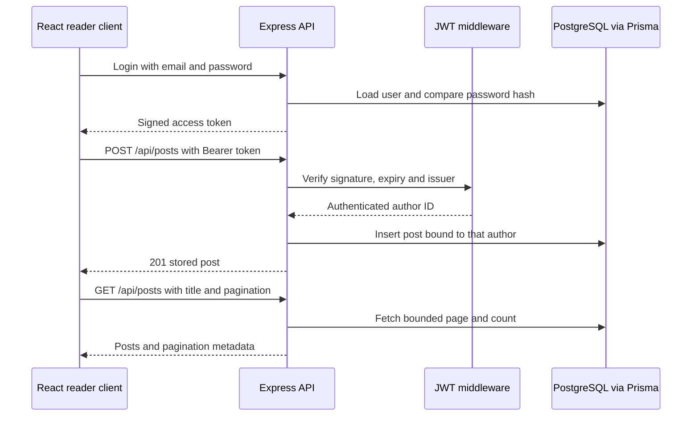
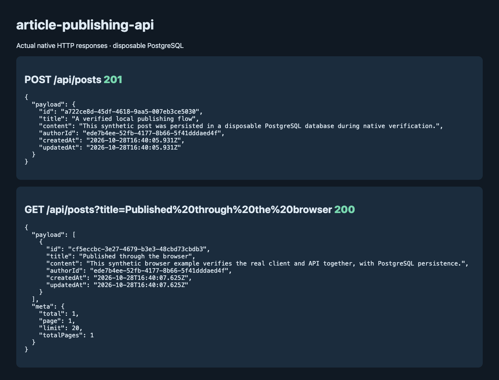

# blogs-server

REST API for a small multi-user blog. Users sign up, log in to get a token, publish posts, and read a paginated list of posts that can be searched by title. It's the backend for a separate React client.

Built with TypeScript, Express 4, Prisma 5 and PostgreSQL. Tests use Mocha, Chai and supertest.

## Endpoints

| Method | Path | Auth | Description |
|---|---|---|---|
| GET | `/health` | no | Status and uptime |
| POST | `/api/auth/signup` | no | Create a user |
| POST | `/api/auth/login` | no | Returns `{authtoken, expiresIn}` |
| GET | `/api/posts` | yes | List posts, supports `?title=`, `?page=`, `?limit=` |
| POST | `/api/posts` | yes | Create a post as the logged-in user |

Send the token as `Authorization: Bearer <token>` or in an `authtoken` header. Responses are wrapped as `{ "payload": ... }`, and the list endpoint adds a `meta` object with `total`, `page`, `limit` and `totalPages`.

## Getting it running

Validated with Node 22 and a PostgreSQL database.

```bash
npm install
cp .env.example .env     # set DATABASE_URL and JWT_KEY
npm run db:generate    # generate the Prisma client after installing
npm run db:migrate
npm run db:seed          # optional sample data
npm run dev              # http://localhost:8080
```

The seed creates `johndoe@example.com` with password `abcd1234`.

With Docker, `docker compose up --build` starts Postgres, runs migrations and serves the API on port 8580. It requires `JWT_KEY` and `POSTGRES_PASSWORD` to be set.

### Config

- `DATABASE_URL`, `JWT_KEY`: required
- `PORT` (default 8080), `JWT_EXPIRES_IN` (1h), `CORS_ORIGINS`, `PAGE_MAX_LIMIT` (100)
- `TEST_DATABASE_URL`: used only by the integration tests

All config is loaded in `src/config/env.ts`.

## Tests and tooling

```bash
npm run test:unit    # no database needed
npm test             # unit + integration, needs TEST_DATABASE_URL
npm run lint
npm run typecheck
npm run build && npm start
```

The integration tests truncate tables, so they refuse to run unless `TEST_DATABASE_URL` is set. A sample run is saved in [docs/test-run.txt](docs/test-run.txt), and a captured API session is in [docs/api-session.txt](docs/api-session.txt).

`npm run benchmark` seeds a throwaway database with synthetic posts and times the list and search queries. Results and query plans are in [docs/benchmarks/](docs/benchmarks/). Don't point it at a database you care about.

## Things to improve

- Pagination uses `OFFSET`, which gets slow for deep pages. Keyset pagination on `(createdAt, id)` would fix that.
- Search is `ILIKE` on titles (backed by a `pg_trgm` index), not full-text search.
- No token revocation, refresh tokens or rate limiting, and posts can't be edited or deleted.

## Publishing path



## Native paired verification



The [captured responses](docs/native-api.json) were produced with a disposable
PostgreSQL database and the real sibling
[article-reader-client](https://github.com/dev-mnadeem/article-reader-client).
Browser login, post creation, feed rendering, and logout were checked on the
built client; access tokens are omitted from the response record.

CI creates an isolated PostgreSQL 16 database, generates Prisma, runs the full
suite, and builds on Node 22. Docker images remain unverified locally.

## Author

[**Muhammad Nadeem**](https://github.com/dev-mnadeem)
