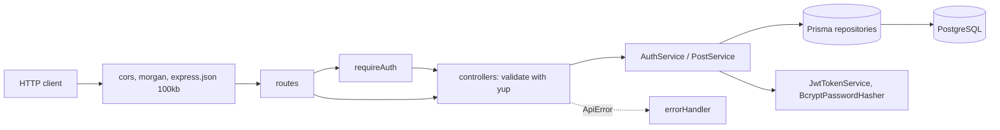
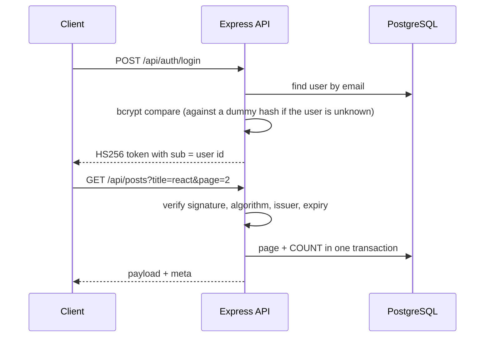

# Article publishing API

`blogs-server` is the REST backend for a small multi-user blog. People sign up, log in for a short-lived access token, publish posts, and read a newest-first, paginated feed they can search by title. It was written to serve a separate React reader client, which is not part of this repository.

The service is small, but it is built the way a larger one would be. It has thin HTTP handlers, services that hold the rules, and repositories that hide Prisma. Every response uses one envelope, failures are typed, and the two queries the feed runs are backed by indexes, with benchmarks in `docs/` that show the effect.

Stack: Node 22, TypeScript 6, Express 5, Prisma 6 and PostgreSQL 16, with yup for validation, jsonwebtoken and bcryptjs for auth, and Mocha, Chai and supertest for tests.

## Run it with Docker Compose

This needs Docker only.

```bash
cp .env.example .env
docker compose up --build --wait
docker compose run --rm migrate npx prisma db seed   # optional sample data
curl -s http://localhost:8580/health
```

Compose starts three services:

- `db`: Postgres 16. Its port is published on 8583.
- `migrate`: a one-shot job that runs `prisma migrate deploy` and exits.
- `api`: the API on port 8580. It starts once `db` is healthy and the migrations have finished.

The seed creates `johndoe@example.com` (password `abcd1234`) with nine posts.

`.env.example` works as it is for local use. Before anything leaves your machine, replace `JWT_KEY` with a random value of at least 32 characters (the comment in the file shows a one-liner) and change `POSTGRES_PASSWORD`. To stop the stack and drop its database volume, run `docker compose down -v`.

## Run it on the host

You need Node 22.12 or newer (`.nvmrc` pins 22) and a Postgres database. The Compose database works: `docker compose up -d db`, and the `DATABASE_URL` in `.env.example` already points at it on port 8583.

```bash
npm ci
cp .env.example .env
npm run db:generate    # generate the Prisma client
npm run db:migrate     # apply prisma/migrations
npm run db:seed        # optional
npm run dev            # http://localhost:8080, restarts on changes
```

To run the compiled build instead, use `npm run build && npm start`.

### Configuration

All config is read and checked once, in `src/config/env.ts`. A `.env` file in the working directory is loaded if one exists. Variables already set in the environment take precedence over it.

| Variable                                | Default                 | Notes                                                                                               |
| --------------------------------------- | ----------------------- | --------------------------------------------------------------------------------------------------- |
| `DATABASE_URL`                          | required                | Postgres connection string                                                                          |
| `JWT_KEY`                               | required                | HMAC signing secret. The process refuses to start in production if it is shorter than 32 characters |
| `JWT_EXPIRES_IN`                        | `1h`                    | Token lifetime, in any value the `ms` package accepts                                               |
| `JWT_ISSUER`                            | `blogs-server`          | Written to `iss` and checked on every request                                                       |
| `PORT`                                  | `8080`                  |                                                                                                     |
| `CORS_ORIGINS`                          | `http://localhost:3000` | Comma-separated allow-list. `REACT_APP_URL` is still read as a fallback                             |
| `BCRYPT_ROUNDS`                         | `10`                    |                                                                                                     |
| `PAGE_DEFAULT_LIMIT` / `PAGE_MAX_LIMIT` | `20` / `100`            | Default and maximum page size                                                                       |
| `POSTGRES_PASSWORD`                     | required by Compose     | Compose builds `DATABASE_URL` from it                                                               |
| `TEST_DATABASE_URL`                     | none                    | Used only by the integration tests                                                                  |

## API

| Method | Path               | Auth | Purpose                                                                                             |
| ------ | ------------------ | ---- | --------------------------------------------------------------------------------------------------- |
| GET    | `/health`          | no   | Process status and uptime                                                                           |
| POST   | `/api/auth/signup` | no   | Create a user from `name`, `email` and `password`                                                   |
| POST   | `/api/auth/login`  | no   | Exchange an email and password for `{ authtoken, expiresIn }`                                       |
| GET    | `/api/posts`       | yes  | Newest-first feed. Takes `?title=`, `?page=` (1 to 1,000,000) and `?limit=` (1 to `PAGE_MAX_LIMIT`) |
| POST   | `/api/posts`       | yes  | Publish a post (`title` of 3 to 200 characters, plus non-empty `content`) as the caller             |

Send the token as `Authorization: Bearer <token>`. The older `authtoken: <token>` header that the React client uses is also accepted. A success comes back as `{ "payload": ... }`, and the feed adds a sibling `meta`. A failure comes back as `{ "payload": {}, "message": "..." }` with the matching status (400, 401, 404, 409, 413). Any unexpected error becomes a 500 with a generic message, so no stack trace or driver error text reaches the client.

### Examples

These were captured from the Compose stack after seeding. The token is shown by its length only. The full session, including the error cases, is in [docs/api-session.txt](docs/api-session.txt).

Sign up, then log in:

```bash
curl -s -X POST http://localhost:8580/api/auth/signup -H 'Content-Type: application/json' \
  -d '{"name": "Ada Lovelace", "email": "ada@example.com", "password": "analytical1843"}'
```

```json
{
  "payload": {
    "id": "aaacd8fa-fe06-461e-a8a4-6bccd89f2e4d",
    "name": "Ada Lovelace",
    "email": "ada@example.com"
  }
}
```

```bash
curl -s -X POST http://localhost:8580/api/auth/login -H 'Content-Type: application/json' \
  -d '{"email": "ada@example.com", "password": "analytical1843"}'
```

```json
{ "payload": { "authtoken": "<access token, 216 characters>", "expiresIn": "1h" } }
```

Publish a post. The `authorId` sent by the client is dropped, and the author always comes from the token:

```bash
curl -s -X POST http://localhost:8580/api/posts -H "authtoken: $TOKEN" -H 'Content-Type: application/json' \
  -d '{"title": "Notes on the Analytical Engine", "content": "The engine weaves algebraic patterns.", "authorId": "someone-else"}'
```

```json
{
  "payload": {
    "id": "93806dc8-6a44-4230-b1ca-6ffebfa5ee3f",
    "title": "Notes on the Analytical Engine",
    "content": "The engine weaves algebraic patterns.",
    "authorId": "aaacd8fa-fe06-461e-a8a4-6bccd89f2e4d",
    "createdAt": "2026-11-07T20:02:47.555Z",
    "updatedAt": "2026-11-07T20:02:47.555Z"
  }
}
```

Read a page of the feed:

```bash
curl -s 'http://localhost:8580/api/posts?limit=3' -H "Authorization: Bearer $TOKEN"
```

```json
{
  "payload": [
    { "id": "acec5c33-…", "title": "100% of the work", "createdAt": "2026-11-07T20:02:47.561Z", "…": "…" },
    {
      "id": "93806dc8-…",
      "title": "Notes on the Analytical Engine",
      "createdAt": "2026-11-07T20:02:47.555Z",
      "…": "…"
    },
    { "id": "fce8b1e8-…", "title": "Learn Nodejs", "createdAt": "2026-11-07T20:02:22.912Z", "…": "…" }
  ],
  "meta": { "total": 11, "page": 1, "limit": 3, "totalPages": 4 }
}
```

The post objects above are shortened for this README. The API returns every field, as in the create response.

Search is a case-insensitive substring match, and `%` and `_` are matched literally:

```bash
curl -s 'http://localhost:8580/api/posts?title=%25' -H "authtoken: $TOKEN"     # one hit: "100% of the work"
curl -s 'http://localhost:8580/api/posts?page=1e20' -H "authtoken: $TOKEN"
```

```json
{ "payload": {}, "message": "page must be less than or equal to 1000000" }
```

## How it is put together



- `src/app.ts` builds the app from its dependencies and never binds a port, so the tests mount the same app in-process. `src/services/container.ts` holds the production wiring. The unit tests run the same services against in-memory repositories (`tests/helpers/inMemoryRepositories.ts`).
- Controllers validate and then call a service. Validation returns the parsed value with strings trimmed, emails lower-cased, numbers coerced and unknown keys stripped, so a client cannot set `authorId` or `isAdmin`.
- Repositories turn Prisma error codes into domain errors. P2002 on `User.email` becomes a 409, which covers two signups that race past the existence check. P2003 on `Post.authorId` (a valid token whose user has since been deleted) becomes a 401.



### Design choices

- **Tokens carry only the user id.** The JWT payload is `sub`, `iss`, `iat` and `exp`, because a signed token is readable by whoever holds it. Verification accepts HS256 only and checks the issuer.
- **Login does not reveal which emails exist.** An unknown email and a wrong password return the same 401 message. An unknown email still costs a bcrypt comparison, so the two cases also take about the same time.
- **The feed order is total.** Posts are ordered by `(createdAt DESC, id DESC)`, backed by an index in the same order. Rows inserted together (the seed's `createMany` gives all nine the same timestamp) therefore cannot repeat or vanish between OFFSET pages.
- **Search uses a trigram index.** `ILIKE '%term%'` cannot use a B-tree index, so the title has a `pg_trgm` GIN index. The term is escaped first, because Prisma passes `contains` through unescaped.
- **Input is bounded.** JSON bodies are capped at 100 KB (413), malformed JSON gets a 400, page size is capped at `PAGE_MAX_LIMIT`, and page numbers are capped so the offset cannot overflow.
- **Shutdown is graceful.** SIGTERM and SIGINT stop the listener and close the Prisma pool. The Docker image runs under `dumb-init`, so the signal actually reaches Node.

## Tests and tooling

```bash
npm run test:unit                                   # 29 tests, no database needed
TEST_DATABASE_URL=postgresql://... npm test         # all 67, needs a throwaway database
npm run typecheck
npm run lint
npm run format:check
```

The integration tests apply the migrations to `TEST_DATABASE_URL` and then truncate its tables before each test. They refuse to run when the variable is not set, so they cannot touch a development database by accident. The suite covers signup, login and token contents, auth failures (missing, forged, expired and wrong-algorithm tokens, and a deleted user), validation, pagination (including rows with identical timestamps), literal search, and malformed or oversized bodies. A recent run is saved in [docs/test-run.txt](docs/test-run.txt).

## Benchmarks

`npm run benchmark` fills the database in `BENCH_DATABASE_URL` with synthetic posts (50,000 by default) and times three queries: an unbounded list, one page with its count, and a title search. It also prints the plan Postgres chose for the search. It writes to the database, so point it at a throwaway one. These results are saved in [docs/benchmarks/](docs/benchmarks/):

|                          | No indexes | Current indexes |
| ------------------------ | ---------- | --------------- |
| One page of 20 + total   | 12.3 ms    | 4.7 ms          |
| Title search, 20 results | 20.8 ms    | 0.7 ms          |

`trigram-index.txt` isolates the trigram index on the search `COUNT`: 26.1 ms with a sequential scan, 5.6 ms with the index.

## Limitations

- Pagination uses OFFSET, so very deep pages get slower. Keyset pagination on `(createdAt, id)` would fix that, and the index is already in place for it.
- Search matches on titles only. It is not full-text search.
- Posts cannot be edited or deleted. There is no token revocation, no refresh token and no rate limiting.
- `/health` reports that the process is up. It does not check the database.

## License

MIT. See [LICENSE](LICENSE).
